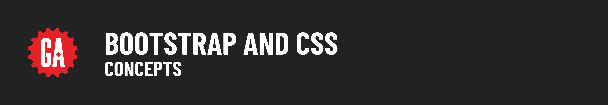

# 

**Learning objective:** By the end of this lesson, students will be able to tktk

## Background
Bootstrap is a free and open-source CSS framework with optional JavaScript components. Originally developed by Twitter as a framework to encourage consistency across internal tools, Bootstrap evolved into "the world’s most popular framework for building responsive, mobile-first sites." If the general appearance and blue shades seemed familiar, now you know why!

To get started with Bootstrap, first go to [Get Bootstrap](http://getbootstrap.com) and click Get Started!
